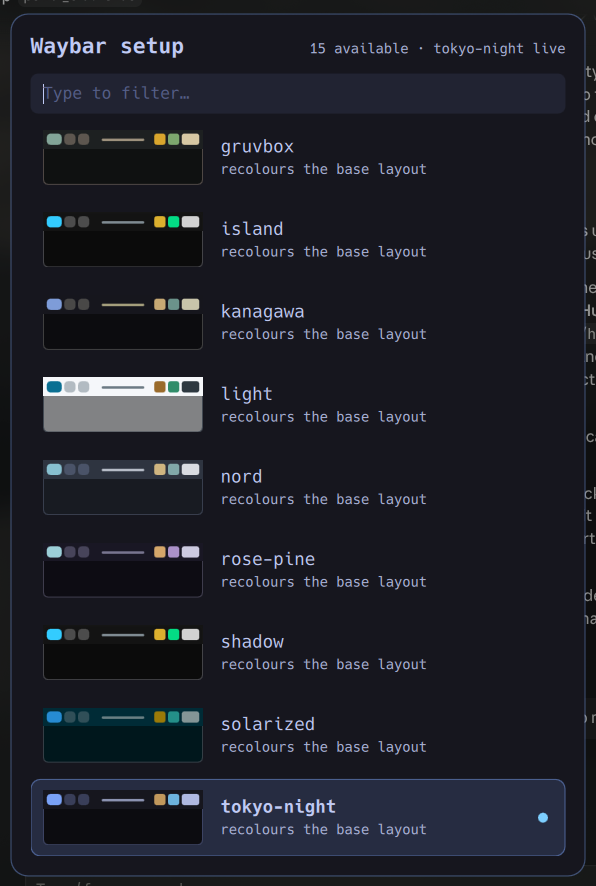

# hyprland_setup

A GUI for Hyprland setup, implemented in [quickshell](https://quickshell.outfoxxed.me/).

Three pages, cycled with `Tab`: which waybar setup is live, which terminal emulator
Hyprland opens, and which wireless network this machine is on. Below them are switches for
the dynamic island and for window shadow and blur.



## What a "setup" is

A setup is a name, discovered from `~/.config/waybar` rather than listed anywhere:

| file | meaning |
| --- | --- |
| `style-<name>.css` | what makes the name exist — a recolour of the base bar |
| `config-<name>.jsonc` | optional; the setup also rearranges modules or moves the bar |
| `style.css` + `config.jsonc` | the setup called `default` |

Dropping a new `style-<name>.css` beside `style.css` is the whole of adding a setup. The
picker will list it on its next run, with a preview built from the colours that stylesheet
actually defines.

Each row previews the bar it would produce — the resolved palette, and the edge the config
puts it on, so `vertical` reads as a vertical bar before you read its name. The previews are
mockups rather than screenshots on purpose: a real screenshot would mean starting waybar
under that setup first, which is the decision you have not made yet.

Colours resolve the way GTK itself resolves `@define-color` — the setup's own stylesheet
first, then the `style.css` it `@import`s, then the shared `~/.config/theme/colors.css` — so
a swatch cannot claim a colour the bar does not render.

## Use

```bash
./bin/waybar-setup-gui
```

Running it again closes it, so it behaves as a toggle when bound to a key. In Hyprland:

```
bindd = $mainMod SHIFT, T, Waybar setup, exec, ~/Documents/GitHub/hyprland_setup/bin/waybar-setup-gui
```

`↑` `↓` move, `Tab` switches page, `Enter` applies, `Ctrl+I` toggles the island, `Ctrl+S`
and `Ctrl+B` toggle window shadow and blur, `Ctrl+W` toggles the wi-fi radio, `Esc`
cancels. Clicking a row applies it; clicking outside cancels.

Typing ranks rather than merely filters, and knows the names are kebab-case, so `tn` finds
`tokyo-night`, `rp` finds `rose-pine`, and `n` puts `nord` above the longer names that also
contain one.

Applying writes the chosen name to `$XDG_STATE_HOME/waybar/theme` and restarts the bar, so
the choice survives a relogin.

## Terminals

The terminals page lists what this machine actually offers, discovered from XDG desktop
entries rather than a hardcoded list, so one installed later appears without editing
anything. Four rules keep it honest, and each excludes something real:

| rule | what it drops |
| --- | --- |
| `TerminalEmulator` must be in the `Categories` *key* | xfce's meta-launcher, which only mentions it in `Exec` |
| `NoDisplay=true` is skipped | GNOME's "Terminal Preferences" |
| only the `[Desktop Entry]` group is read | gnome-terminal's actions, which would appear as three terminals |
| `TryExec`, or `Exec`'s first word, must resolve | anything with a desktop entry but no binary |

Hyprland freezes `$terminal` at parse time, so the choice cannot live in `hyprland.conf`
and still change while the session runs. It goes to `$XDG_STATE_HOME/hypr/terminal`, and
`hypr/scripts/terminal.sh` reads it at every launch — the same shape `waybar-launch.sh`
uses for the theme, and for the same reason: writing into `~/.config/hypr` would dirty the
dotfiles repo on every switch.

```bash
./scripts/hypr-terminal list        # what is installed, as TSV
./scripts/hypr-terminal current     # what SUPER+Q will open
./scripts/hypr-terminal apply kitty
```

### Where it opens

`SUPER+Q` opens the terminal wherever the layout puts it. `SUPER+SHIFT+Q` opens the same
one floating, at the position and size the last one had:

```bash
./scripts/hypr-terminal-last           # open there, and go on recording
./scripts/hypr-terminal-last geometry  # what is remembered, as TSV
./scripts/hypr-terminal-last forget    # start over
./scripts/hypr-terminal-last fit 2400 180 700 450   # where that box would land today
```

Nothing in Hyprland remembers either across a relogin — this build has no
`persistentsize` rule, and a window rule is config rather than state — so the script
records the geometry while the window lives and replays it on the next open. Three things
shaped it:

| | |
| --- | --- |
| the new window is found by diffing `hyprctl clients` | `exec [float;move ...]` rules are matched on the spawned PID, so they land on nothing for a single-instance terminal — ghostty's entry passes `--gtk-single-instance=true` |
| the geometry is polled, not watched | Hyprland emits `movewindowv2` but has no resize event at all, so a socket watcher would remember a drag of the window and miss every drag of its edge |
| only a floating, non-fullscreen window is recorded | a tiled window's geometry is the layout's rather than yours, and a fullscreen box would come back as a window the size of the monitor |

The geometry survives a relogin by itself, being a plain file under `$XDG_STATE_HOME`: the
recorder dies with the session and leaves nothing behind but a stale pid file, which the
next open steps over rather than signalling a recycled stranger. What does not survive is
the *monitor*. Park the terminal on an external, relogin undocked, and the saved position
is still valid arithmetic — and Hyprland does not clamp it, so a restore to `x=2400` on
this 1536-wide panel lands at `x=2400`, reachable only through `hyprctl`.

So a box is restored verbatim only while it leaves at least a 200x100 patch on one monitor
and fits inside it; otherwise it is capped and pulled in, onto the monitor it overlaps most
or the focused one when it overlaps none. A window deliberately hanging off an edge keeps
hanging off it, and one whose monitor is gone comes back on a monitor that exists. `fit`
answers that arithmetic without plugging anything in, which is how the docked and
rotated-90° cases were checked.

One recorder runs at a time, so the terminal opened most recently owns the memory. The
bind lives in the dotfiles, beside the plain `SUPER+Q` one:

```
bindd = $mainMod SHIFT, Q, Terminal at its last position, exec, ~/Documents/GitHub/hyprland_setup/scripts/hypr-terminal-last
```

## Wi-Fi

The third page lists what is in range, strongest first, and `Enter` joins the selected one.
A saved network connects straight away; an open one joins with no prompt, which the row
says in the warning colour before you press anything; a secured one you have never used
turns the filter field into a password field and connects on the next `Enter`.

NetworkManager is the only backend. It is what is running here, and a second one would not
be another list to parse but a different model of what a saved network is.

```bash
./scripts/hypr-wifi list              # what is in range, as TSV
./scripts/hypr-wifi current           # the SSID this machine is on
./scripts/hypr-wifi status            # device, state, SSID and radio, as TSV
./scripts/hypr-wifi rescan            # ask for a fresh scan; does not wait for it
./scripts/hypr-wifi radio toggle      # also: radio on | off
./scripts/hypr-wifi connect --ask "Some SSID"
./scripts/hypr-wifi disconnect
./scripts/hypr-wifi forget "Some SSID"
```

### The password never reaches a command line

`/proc/<pid>/cmdline` is world-readable, so the obvious

```
nmcli device wifi connect "$ssid" password "$pw"
```

hands the key to every process on the machine for as long as nmcli runs. Instead the
password arrives on stdin — `connect --password-stdin`, which is what the panel uses, or
`--ask`, which reads the tty — and reaches nmcli through `connection up ... passwd-file`,
a file written with `umask 077` under `$XDG_RUNTIME_DIR` and removed by a single `trap` on
the way out. Two things that look right and are not:

| | |
| --- | --- |
| a `trap` set next to the `local` holding the path | a trap body is evaluated when it *fires*, by which time the function has returned — under `set -u` that is an unbound variable at exit, and a secret still on disk after the connect that **succeeded** |
| `SECRET_FILE=$(passwd_file …)` | the assignment inside a command substitution happens in a subshell, so the global the trap reads stays empty and nothing is ever deleted |

That is also why `nmcli device wifi connect`, whose only password option is on the command
line, is used for open networks alone, and a secured network's profile is built in two
steps instead — added without the secret, then activated with it.

### What `saved` means

Whether a profile is *named* after the SSID, which is what nmcli, GNOME and netplan all do
when they create one. Asking NetworkManager properly costs one `nmcli connection show` per
wireless profile — 420ms for the 23 on this machine, against 17ms for the scan itself —
and that is not worth 25x on the path that draws the list.

So a profile renamed away from its SSID reads as unsaved, and the only cost is a password
prompt that was not needed: `connect` resolves it exactly, and brings the existing profile
up with whatever it was handed. A network whose key has changed is reconnected the same
way, without forgetting it first.

### The rest of the shape

| | |
| --- | --- |
| one row per SSID, not per access point | a mesh or a dual-band router answers the scan once per radio, and three rows called `saigon-sh` are three ways to say the same thing — the strongest wins, and "in use" is true if any of its radios is the one we are on |
| `list` passes `--rescan no` | nmcli's default blocks for seconds whenever NetworkManager's cache is older than 30s; the panel asks for a scan when the page is opened and picks the results up three seconds later |
| hidden networks are dropped | they come back with an empty SSID: no name to show, and no name to connect by |
| `--ask` prompts only once a key is known to be needed | asking first means `connect --ask "Some SSID"` takes a password and *then* says the network is not in range; an open network is never asked about at all, and a saved one is, since that is how a rotated key gets in |
| 802.1X is refused with a message | an enterprise network needs more than a password, and guessing at it in a picker is worse than saying so |
| activation waits 25s, not nmcli's 90 | the caller is a modal panel holding the keyboard, and an association plus DHCP does not take longer than that when it is going to work |
| a failed first connect deletes the profile it just made | otherwise a typo leaves one behind that NetworkManager keeps retrying, and that the next `list` shows as saved |

Signal is drawn as four bars rather than set from a Nerd Font codepoint. The
wifi-strength glyphs live in the Material Design private-use block, so a font built without
it renders four different networks as four identical tofu boxes — and strength is the one
thing that row exists to show.

Nothing here needs a state file. Unlike the waybar theme and the terminal, the choice of
network *is* the system state, and NetworkManager already persists it.

## Dynamic island

A pill under the bar that wakes up when something happens worth a glance — the volume
moved, the track changed — and goes quiet again a couple of seconds later. It reads the
same resolved palette the picker does, so it wears whatever the bar is wearing, and
re-reads it when the theme state file changes.

```bash
./bin/island toggle     # also start | stop | status
```

Or from the panel: the row at the bottom, or `Ctrl+I`.

It runs as its own quickshell config rather than inside the panel, because their lifetimes
are opposites — the panel is launched on a key, applies one thing and exits, while the
island has to outlive every switch. The panel starts and stops it; closing the panel
leaves it running.

Nothing starts it at login yet. Add one line if you want it always on:

```
exec-once = ~/Documents/GitHub/hyprland_setup/bin/island start
```

## Window effects

The `Window effects` row switches Hyprland's window shadow and blur for every window,
whatever setup is live. `Ctrl+S` and `Ctrl+B` do the same from the keyboard.

```bash
./scripts/hypr-effects status        # what you asked for, as TSV
./scripts/hypr-effects toggle blur   # also: set shadow on|off
./scripts/hypr-effects restore       # re-apply the saved choice
```

The choice goes to `$XDG_STATE_HOME/hypr/effects`, not into the Hyprland config. A config
write triggers an autoreload, and a reload drops the theme colours `theme-apply.sh` pushed
in at runtime. The file only survives a reload because the dotfiles run `restore` from an
`exec =` line, which runs after every reload rather than once at login:

```
exec = sh -c 'test -x ~/Documents/GitHub/hyprland_setup/scripts/hypr-effects && ~/Documents/GitHub/hyprland_setup/scripts/hypr-effects restore'
```

Performance mode (`SUPER+SHIFT+P`) still turns both off. A switch flipped while it is on
is saved and applies when it ends. An effect never flipped here is not in the file, so it
follows `conf.d/appearance.conf`.

## Without the GUI

Everything the GUI knows comes from one script, which is usable on its own — and is the
thing to reach for when it is the GUI that is misbehaving:

```bash
./scripts/waybar-setup list       # every setup, with its resolved colours, as TSV
./scripts/waybar-setup current    # the setup that is live right now
./scripts/waybar-setup apply nord # switch, and restart the bar
```

`current` reads the running waybar's command line rather than the state file. The state file
records what the *next* login will start, and the two drift the moment waybar is started by
hand — trusting it would mark the wrong row as live.

## Layout

| path | |
| --- | --- |
| `shell.qml` | entry point; owns every process call and all CSS parsing |
| `Picker.qml` | the overlay window, filtering and keyboard handling |
| `SetupCard.qml` | one row of the waybar page |
| `TerminalCard.qml` | one row of the terminals page |
| `WifiCard.qml` | one row of the wi-fi page |
| `BarPreview.qml` | the miniature bar |
| `island.qml` | the island's entry point; sources, state and window |
| `IslandPill.qml` | the pill that morphs |
| `bin/island` | start / stop / toggle / status |
| `modules/common/Fuzzy.qml` | ranking for the filter |
| `modules/common/PickerState.qml` | the cache, as a `FileView` + `JsonAdapter` |
| `scripts/waybar-setup` | discovery, colour resolution, applying |
| `scripts/hypr-terminal` | terminal discovery and choice |
| `scripts/hypr-terminal-last` | the floating terminal that reopens where it was |
| `scripts/hypr-effects` | window shadow and blur, and restoring them after a reload |
| `scripts/hypr-wifi` | networks in range, and joining one |
| `bin/waybar-setup-gui` | toggling launcher |

QML only ever sees resolved values; paths, processes and CSS stop at `shell.qml`.

Singletons live under `modules/` and are imported as `qs.modules.common` — quickshell
registers the config root as `qs`, so no `qmldir` is needed.

## Startup

The picker paints from a cache at `$XDG_STATE_HOME/hyprland-setup/picker.json` and starts a
live refresh at the same time, so rows are on screen at ~14ms rather than ~137ms and a
stylesheet added since the last run appears a frame later. What is cached is the helper's
raw stdout, so there is only one parsing path rather than a second one for JSON.

`waybar-setup list` reads each stylesheet in a single `awk` pass. Resolving ten tokens with
a `grep` apiece across three files for fifteen setups meant roughly 1350 process spawns and
a full second before the first row could be drawn.

## Requires

quickshell 0.3, Qt 6.5+ (for `Qt.alpha`), a wlroots compositor, a waybar config laid out as
above, and NetworkManager for the wi-fi page. It hands the actual relaunch to `~/.config/hypr/scripts/waybar-launch.sh` when that
exists, so the launch has a single owner, and falls back to invoking waybar directly when it
does not.
